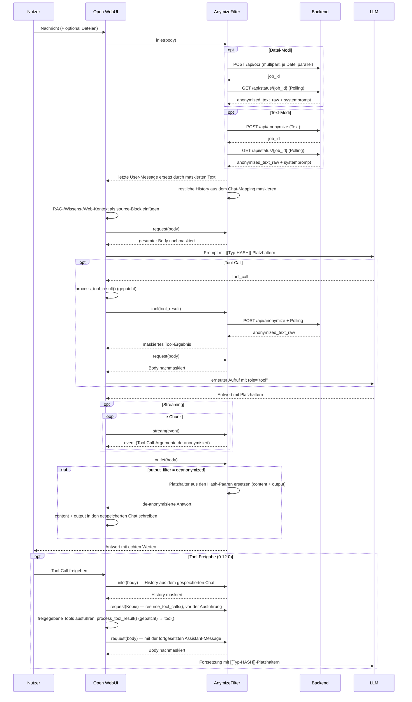

# AnonymizeFilter

Ein [Open WebUI](https://github.com/open-webui/open-webui)-Filter, der personenbezogene Daten (PII) aus Chat-Eingaben entfernt, bevor sie an ein LLM gehen — und sie in der Antwort wieder einsetzt.

Die Anonymisierung selbst passiert nicht lokal, sondern über die externe API. Der Filter ersetzt PII durch Platzhalter der Form `[[Typ-HASH]]` (z. B. `[[Person-QSEZB6]]`), schickt den maskierten Text ans Modell und macht die Maskierung nach der Antwort wieder rückgängig.

**Lokal steht der Klartext, ausgehend die Platzhalter.** Die de-anonymisierte Antwort landet im gespeicherten Chat — Open WebUI schreibt das Ergebnis von `outlet()` selbst zurück —, und weil dieser Verlauf mit der nächsten Frage wieder mitgeschickt wird, maskiert `inlet()` die **gesamte** Unterhaltung erneut — lokal, aus der Zuordnungstabelle des Chats, ohne weiteren API-Call. Dieselbe Person behält dabei über alle Turns denselben Platzhalter. Siehe [Kontext über mehrere Turns](#kontext-über-mehrere-turns).

Der gesamte Filter steckt in einer Datei: [`anonymize.py`](anonymize.py). Vorausgesetzt wird **Open WebUI 0.11.2 oder neuer** (geprüft gegen 0.11.4 und 0.12.0), siehe [Voraussetzungen](#voraussetzungen).

---

## Funktionsweise



### Ablauf im Detail

1. **`inlet()`** wird von Open WebUI vor dem LLM-Aufruf gerufen und delegiert an `process_input()`.
2. **Dateien** (Modi `file_anonymization`, `text_file_anonymization`): `get_file_paths()` baut aus `body["files"]` die Pfade `UPLOAD_DIR/{file_id}_{filename}`. `process_multiple_files_for_ocr()` lädt alle Dateien parallel an `POST /api/ocr` hoch — zusammen mit der in der Valve `language` gesetzten Sprache —, sammelt die Job-IDs und pollt sie parallel bis `status == "completed"`. Ergebnis: `anonymized_text_raw` je Datei.
3. **Text**: der Text der letzten User-Message wird an den OCR-Text angehängt.
4. **Anonymisierung** (Modi `text_anonymization`, `text_file_anonymization`): der kombinierte Inhalt geht mit der konfigurierten Sprache an `POST /api/anonymize`, die zurückgegebene `job_id` wird über `GET /api/status/{job_id}` gepollt. Der von der API gelieferte `systemprompt` (Regeln zum korrekten Umgang mit Platzhaltern) wird an den Inhalt angehängt. Bei `output_filter = "deanonymized"` holt `_store_hash_pairs()` anschließend über `GET /api/status/{job_id}/strings` die vollständige Zuordnungstabelle und legt sie in `__metadata__` **und** in der Tabelle des Chats ab — daraus lebt die gesamte Rückabbildung. Bei `"anonymized"` unterbleibt der Abruf.
5. **Ersetzen**: `final_content` ist immer der `anonymized_text_raw` der API, ergänzt um den `systemprompt`. Damit wird die letzte User-Message im `body` überschrieben. Open WebUI schickt sie so ans Modell — das LLM sieht nur Platzhalter. Vergibt der Job für eine Entität einen neuen Platzhalter, obwohl der Chat für denselben Originalwert längst einen hat, wird der frische auf den bekannten umgeschrieben (`_alias_placeholders()`); sonst wäre dieselbe Person für das Modell zwei.
    - **Re-Maskierung der History**: `_remask_history()` schickt jede weitere Nachricht der Unterhaltung (`user`, `assistant`, `tool`) durch `_mask_text()` — Originalwert → Platzhalter, aus der Zuordnungstabelle des Chats, ohne API-Call. Nötig, weil `outlet()` die Originalwerte lokal festschreibt und Open WebUI diesen Verlauf mit der nächsten Frage wieder mitschickt. Fehlt die Tabelle (Neustart, Reload, anderer Worker), wird sie einmal je Chat aus der History rekonstruiert. Siehe [Kontext über mehrere Turns](#kontext-über-mehrere-turns).
6. **`tool()`** wird für jedes Tool-Ergebnis gerufen — nicht von Open WebUI, sondern aus dem Monkey Patch von `middleware.process_tool_result()`, den der Filter beim Laden installiert. Das bereits zu Text normalisierte Ergebnis läuft durch dieselbe Anonymisierung wie die User-Message und geht maskiert als `role="tool"`-Message ans Modell. Steht der Tool-Name in der Valve `tool_filter_exclude`, wird das Ergebnis unverändert durchgereicht. Siehe [Tool-Ergebnisse](#tool-ergebnisse).
7. **`stream()`** wird bei aktivem Streaming für jeden Chunk der Antwort gerufen. Chunks des Antworttexts gehen unverändert durch. Bei `output_filter = "deanonymized"` werden in Chunks mit `delta.tool_calls` die Platzhalter in `function.arguments` durch die Originalwerte aus der Zuordnungstabelle in `__metadata__` ersetzt, bevor Open WebUI die Argumente zusammensetzt und das Tool aufruft — siehe [Tool-Call-Argumente](#tool-call-argumente).
8. **`outlet()`** wird nach der LLM-Antwort gerufen. Zuerst schreibt `_log_hash_pairs()` die in `__metadata__` gesammelte Zuordnungstabelle einmal ins Serverlog — ohne die Originalwerte. Danach: bei `output_filter = "deanonymized"` werden die Platzhalter der Assistant-Nachricht lokal aus denselben Paaren ersetzt, mit denen `stream()` arbeitet; kein Request ans Backend. Ersetzt wird in `message["content"]` **und** in den strukturierten `message["output"]`-Blöcken: das Frontend rendert eine Assistant-Nachricht aus diesen Blöcken und greift auf `content` nur zurück, wenn keine da sind (`ContentRenderer.svelte`: `{#if output?.length}`) — eine gestreamte Antwort trägt sie immer, ohne diesen Schritt bliebe der Text mit Platzhaltern auf dem Bildschirm stehen. Jedes Textelement wird für sich ersetzt, Reihenfolge und Anzahl der Blöcke bleiben unangetastet; der Ansatz stammt aus dem PoC in [`hook_logger.py`](hook_logger.py). Den Rest erledigt Open WebUI: `outlet_filter_handler()` vergleicht das Ergebnis mit der gespeicherten Nachricht und schreibt zurück, was sich geändert hat — `content`, `output` und den vorherigen Text als `originalContent`. Der gespeicherte Chat trägt ab hier den Klartext, sonst führte Open WebUI die Unterhaltung mit dem gestreamten, maskierten Text fort. Bei `"anonymized"` bleibt die Antwort unverändert, die Platzhalter bleiben sichtbar.
9. **`request()`** wird seit Open WebUI 0.11.2 vor **jedem** Provider-Call gerufen — am Ende von `process_chat_payload()`, nach einer Tool-Freigabe und vor jeder Fortsetzung der Tool-Call- und Code-Interpreter-Schleife. Das ist die letzte Stelle vor dem Modell, und sie sieht alles, was Open WebUI dem Body **nach** `inlet()` noch hinzufügt. Der Hook schickt den gesamten Verlauf erneut durch `_mask_messages()` — lokal, idempotent, ohne API-Call. Siehe [Der `request`-Hook](#der-request-hook).
10. **Statusmeldungen** („Processing files…", „Anonymizing content…", „Anonymizing result of &lt;tool&gt;…", „De-anonymizing content…") laufen über `__event_emitter__` und erscheinen im Chat-Verlauf.
11. **Fehler**: `inlet()` meldet `❌ Anonymization failed: …` und wirft eine Exception — die Anfrage geht nicht ans LLM. `tool()` wirft nicht, sondern ersetzt das Tool-Ergebnis durch die Fehlermeldung (fail closed). `outlet()` wirft ebenfalls nicht, sondern stellt der Originalantwort die Fehlermeldung voran, damit die Antwort nicht verloren geht.

---

## Installation

1. In Open WebUI: **Admin Panel → Functions → `+`** (neue Function anlegen).
2. Inhalt von [`anonymize.py`](anonymize.py) einfügen und speichern. Titel, Autor und Version zieht Open WebUI aus dem Docstring am Dateianfang.
3. Function aktivieren und entweder global oder pro Modell zuweisen.
4. Unter **Valves** den API-Key hinterlegen (siehe unten).
5. Im Chat lässt sich der Filter über sein Icon ein- und ausschalten (`self.toggle = True`). Ist er aus, ruft Open WebUI `inlet()`, `stream()` und `outlet()` gar nicht erst auf — `self.toggle` bleibt dabei unverändert `True`, den Zustand des Schalters trägt allein `metadata["filter_ids"]`. Weil Tool-Ergebnisse nicht über die Filter-Pipeline laufen, sondern über den Monkey-Patch, prüft `_filter_enabled()` diese Liste dort ein zweites Mal; ist der Schalter aus, geht das Tool-Ergebnis unverändert an das Modell. Die eigene Function-ID dafür liest der Filter aus seinem Modulnamen — `function_<id>` bis 0.11.x, `function_<id>_<uuid-hex>` ab 0.12.0 (`_function_id_from_module_name()`); sie steht in der Log-Zeile `process_tool_result patch installed (function id '<id>')` und muss dort der in Open WebUI vergebenen ID entsprechen. Lässt sich der Zustand nicht ermitteln (fehlende Metadaten, ältere Open-WebUI-Version), wird sicherheitshalber anonymisiert.

---

## Konfiguration (Valves)

| Valve | Default | Bedeutung |
|---|---|---|
| `backend_url` | z.B. `https://app.anymize.ai` | Basis-URL des anymize-Backends, ohne Pfad. Nur ändern, um eine self-hosted oder Staging-Instanz anzusprechen. Ein abschließender `/` wird abgeschnitten; leer gelassen greift wieder der Default. |
| `anymize_api_key` | `""` | API-Key des Backends, Format z.B. `anymize_xxxxxxxxxxxxx`. Wird als `Authorization: Bearer …` gesendet. |
| `language` | `de` | Sprache der PII-Erkennung; gilt für `/api/anonymize` **und** `/api/ocr`. Mögliche Werte: `de`, `en`, `fr`, `es`, `it`. |
| `label_ids` | `""` | Kommagetrennte Liste von Label-IDs, die als `label_ids` bei jedem `POST /api/anonymize` mitgeschickt wird und die Erkennung auf diese Entitätstypen einschränkt, z.B. `PERSON, IBAN`. Die Werte gehen unverändert raus, Groß-/Kleinschreibung zählt. Gilt für User-Input **und** Tool-Ergebnisse, nicht für `/api/ocr`. Leer = das Feld wird gar nicht gesendet, es greift der Default des Backends. |
| `input_filter` | `text_anonymization` | Was vor dem LLM verarbeitet wird — siehe Modi unten. |
| `output_filter` | `deanonymized` | Was mit der LLM-Antwort passiert — siehe unten. |
| `tool_filter` | `true` | Maskiert das Ergebnis jedes Tool-Calls, bevor es das Modell sieht — siehe [Tool-Ergebnisse](#tool-ergebnisse). Braucht den Monkey Patch von `middleware.process_tool_result`, der beim Laden des Filters installiert wird. |
| `tool_filter_exclude` | `""` | Kommagetrennte Liste von Tool-Namen, deren Ergebnis **nicht** maskiert und unverändert an das LLM durchgereicht wird, z.B. `get_time, enaio_*`. Groß-/Kleinschreibung egal, Wildcards erlaubt — siehe [Ausgeschlossene Tools](#ausgeschlossene-tools). Wirkt nur, solange `tool_filter` an ist. ⚠️ Das Ergebnis eines ausgeschlossenen Tools erreicht das Modell im Klartext. Leer = jedes Tool-Ergebnis wird maskiert. |
| `history_remasking` | `true` | Maskiert vor dem Senden die **gesamte** Unterhaltung, nicht nur die neueste User-Message — nötig, weil der lokale Kontext die Originalwerte hält. Läuft lokal aus der Zuordnungstabelle des Chats, ohne weiteren API-Call; fehlt sie, wird sie einmal je Chat mit einem Job aus der History rekonstruiert. Aus = altes Verhalten, nur die letzte User-Message wird maskiert. Siehe [Kontext über mehrere Turns](#kontext-über-mehrere-turns). |
| `chat_mapping_max_chats` | `200` | Wie viele Chats ihre Zuordnungstabelle im Speicher behalten (LRU). Fällt ein Chat heraus, lassen sich seine alten Platzhalter nicht mehr auflösen und sein Klartext nicht mehr re-maskieren. ⚠️ Die Tabelle enthält die Originalwerte — dieser Wert begrenzt damit auch die PII im Prozessspeicher. |
| `log_tool_payload` | `false` | Schreibt die Parameter jedes `process_tool_result()`-Aufrufs sowie jedes Tool-Ergebnis vor und nach der Maskierung vollständig ins Serverlog. ⚠️ Das rohe Ergebnis steht damit im Klartext im Log. Aus = kompakte Zeilen mit Typ, Länge und Korrelations-IDs. |
| `priority` | `10` | Ausführungsreihenfolge unter mehreren Filtern; kleinere Werte laufen zuerst. |

### `input_filter`-Modi

| Wert | Verhalten |
|---|---|
| `text_anonymization` | Nur die letzte User-Message wird über `/api/anonymize` maskiert. Dateien werden ignoriert. |
| `file_anonymization` | Angehängte Dateien laufen durch `/api/ocr` (OCR + Anonymisierung in einem Schritt). Maskiert wird gezielt nur der Dateiinhalt; der getippte Text der User-Message wird unverändert angehängt. Wer beides maskieren will, nimmt `text_file_anonymization`. |
| `text_file_anonymization` | Dateien per OCR **und** der kombinierte Gesamttext anschließend per `/api/anonymize`. |

### `output_filter`-Modi

| Wert | Verhalten |
|---|---|
| `deanonymized` | Der einzige Schalter für die gesamte Rückabbildung: nach jedem Job wird die Zuordnungstabelle über `GET /api/status/{job_id}/strings` geholt und in `__metadata__` gesammelt, `stream()` setzt die Originalwerte in die Argumente eines Tool-Calls ein (siehe [Tool-Call-Argumente](#tool-call-argumente)), `outlet()` in die Antwort. Die Ersetzung läuft lokal aus den Paaren, ohne weiteren Backend-Request. |
| `anonymized` | Es wird keine Zuordnungstabelle abgerufen. Die Platzhalter `[[Typ-HASH]]` bleiben überall stehen — im Chat **und** in den Argumenten eines Tool-Calls, der damit sein Ziel nicht findet. |

---

## Genutzte API-Endpunkte

Basis-URL: die Valve `backend_url`, per Default `https://app.anymize.ai`. Auth über `Authorization: Bearer <api_key>`. Alle Endpunkte unten hängen an dieser Basis, auch der Multipart-Upload nach `/api/ocr`.

| Endpoint | Zweck | Aufruf im Code |
|---|---|---|
| `POST /api/anonymize` | Text maskieren, liefert `job_id`; Body `text` + `language`, dazu optional `label_ids` aus der gleichnamigen Valve | [`_anonymize_text()`](anonymize.py:1051) |
| `GET /api/status/{job_id}` | Job-Status + `anonymized_text_raw` + `systemprompt` | [`_get_anonymization_status()`](anonymize.py:1070) |
| `GET /api/status/{job_id}/strings` | Zuordnungstabelle Platzhalter ↔ Originalwert; nur bei `output_filter = "deanonymized"`, wird dann in `__metadata__` abgelegt und ist die Grundlage jeder Rückabbildung | [`_get_hash_pairs()`](anonymize.py:1074), [`_store_hash_pairs()`](anonymize.py:1078), [`_log_hash_pairs()`](anonymize.py:1130) |
| `POST /api/ocr` | Datei (PDF, PNG, JPG, TIFF) per multipart, OCR + Anonymisierung | [`upload_file_from_path_for_ocr()`](anonymize.py:1167) |


---

## Code-Aufbau

Alles in `class Filter` in [`anonymize.py`](anonymize.py):

| Gruppe | Methoden |
|---|---|
| Konfiguration | `Valves` (pydantic-Model), `__init__()` — setzt `toggle` und das Inline-SVG-Icon, `base_url` (Property) — Basis-URL aus der Valve `backend_url`, ohne abschließenden `/` |
| Zuordnungstabelle | `_get_hash_pairs()`, `_store_hash_pairs()` — Abruf und Ablage in `__metadata__`, nur bei `output_filter = "deanonymized"`; `_log_hash_pairs()` — Ausgabe der gesammelten Tabelle ohne Originalwerte (`HASH_PAIR_LOG_FIELDS`), einmal je Request aus `outlet()`; `_deanonymize` (Property) — der eine Modus-Check, den `_store_hash_pairs()`, `stream()` und `outlet()` teilen |
| HTTP | `_anymize_api_request()` — aiohttp-Wrapper für GET/POST mit Bearer-Auth |
| API-Calls | `_anonymize_text()`, `_get_anonymization_status()`, `upload_file_from_path_for_ocr()` |
| Job-Polling | `_poll_status()` — pollt bis `status == "completed"`, `max_retries=150`, `retry_interval=500` ms |
| Chat-Mapping | Modul-Ebene: `_STATE` — Prozess-Speicher je `chat_id`, überlebt das Neu-Laden des Filter-Moduls; `_chat_entry()`, `_chat_pairs()`, `_remember_pairs()` — Ablage mit LRU-Deckel; `_alias_placeholders()` — frischer Platzhalter → der im Chat schon genutzte; `_canonical_placeholders()` — Originalwert → Platzhalter für die Maskierung; `_mask_text()` — die Ersetzung in Gegenrichtung zu `_replace_placeholders()`; `_apply_to_message_text()`, `_message_text()` — Text einer Nachricht in allen drei Formen (String, Parts-Liste, `output`-Blöcke); `_orphan_placeholders()` — Platzhalter, die keine Tabelle mehr auflöst. In der Klasse: `_remask_history()` — die History in `inlet()`, `_mask_messages()` — die Ersetzungsschleife, die `_remask_history()` und `request()` teilen, `_rebuild_chat_mapping()` |
| Datei-Handling | `get_file_paths()`, `process_multiple_files_for_ocr()` — Upload und Polling parallel via `asyncio.gather()` |
| Orchestrierung | `_anonymize_content()` — ein Text von der Abgabe bis zum maskierten Ergebnis (Job, Polling, Zuordnungstabelle); genutzt von `process_input()` und `tool()`. `process_input()` — sammelt Inhalte, ruft die Anonymisierung, überschreibt die letzte User-Message |
| Open-WebUI-Hooks | `inlet()` (vor dem LLM), `request()` (vor jedem Provider-Call, ab 0.11.2), `stream()` (je Chunk), `outlet()` (nach dem LLM) — alle mit `__metadata__` |
| Monkey Patch | Modul-Ebene: `_unwrap()`, `_bind_call()`, `_install_process_tool_result_patch()` — `middleware.process_tool_result` für die Tool-Ergebnisse, in `__init__()` installiert und über Reloads hinweg idempotent; `_check_owui_version()` — prüft die Open-WebUI-Version gegen `_MIN_OWUI_VERSION` |
| Rückabbildung | Modul-Ebene: `_placeholder_map()` — Platzhalter → Originalwert aus den Hash-Paaren, mit `for_json=True` JSON-escaped für `stream()`, roh für `outlet()`; `_replace_placeholders()` — die Ersetzung selbst, von beiden genutzt; `_split_pending()` — hält einen über Chunk-Grenzen zerteilten Platzhalter zurück. In der Klasse: `_deanonymize_tool_calls()` — bearbeitet einen Chunk; `_deanonymize_message()` — ersetzt in einer Assistant-Message, `_output_text_items()` — findet den vom Frontend gerenderten Text in `message["output"]`, `_prefix_assistant_text()` — stellt der Antwort die Fehlermeldung voran; `_log_missing_pairs()` — Warnung einmal je Request |
| Tool-Ergebnisse | Modul-Ebene: `_anonymize_tool_result()`; `_filter_enabled()` — Zustand des Chat-Schalters aus `metadata["filter_ids"]`, `_function_id_from_module_name()` — die eigene Function-ID dafür; `_parse_tool_patterns()`, `_tool_excluded()` — Auswertung der Valve `tool_filter_exclude`. In der Klasse: `tool()` — siehe [Tool-Ergebnisse](#tool-ergebnisse) |

### Hash-Paare in `__metadata__`

> Dieser Abschnitt greift nur bei `output_filter = "deanonymized"`. Im Modus `"anonymized"` wird die Tabelle nicht abgerufen, und in `__metadata__` steht nichts davon.

`__metadata__` ist ein Live-Dict, das Open WebUI durch den Request-Lebenszyklus reicht: was `inlet()` hineinschreibt, sieht `outlet()` desselben Requests ([Doku](https://docs.openwebui.com/features/extensibility/plugin/functions/filter/#data-passing-between-filters)). `_store_hash_pairs()` legt die vollständige Zuordnungstabelle dort ab — pro Request, nicht als geteilter Zustand der Filter-Instanz. `stream()` und `outlet()` lesen anschließend daraus:

| Key (`Filter.METADATA_*`) | Inhalt |
|---|---|
| `_anymize_hash_pairs` | `List[Dict[str, Any]]` — ein Dict je erkannter Entität, **angehängt** über alle Jobs des Requests (Eingabe und Tool-Ergebnisse) |
| `_anymize_job_id` | `str` — Job-ID der Eingabe-Anonymisierung aus `inlet()` |
| `_anymize_tool_job_ids` | `List[str]` — Job-IDs der in diesem Request anonymisierten Tool-Ergebnisse, in Aufrufreihenfolge |
| `_anymize_tool_call_buffer` | `Dict[int, str]` — je Tool-Call-Index das Ende, das `stream()` zurückhält, weil daraus noch ein Platzhalter werden kann |
| `_anymize_tool_call_no_pairs_logged` | `bool` — gesetzt, sobald `stream()` oder `outlet()` das Fehlen der Zuordnungstabelle gemeldet hat, damit die Warnung einmal je Request steht statt einmal je Chunk |

Zugriff in `outlet()`:

```python
hash_pairs = (__metadata__ or {}).get(Filter.METADATA_HASH_PAIRS_KEY, [])
```

Je Eintrag werden die in `Filter.HASH_PAIR_FIELDS` gelisteten Felder übernommen: `original`, `hash`, `prefix_name`, `placeholder`. Fehlende Felder werden als `None` abgelegt.

Alle drei Hooks deklarieren `__metadata__` mit Default `None`, und `_store_hash_pairs()` schreibt nur, wenn das Dict tatsächlich übergeben wurde **und** der Modus stimmt. Ohne Metadata läuft die Anonymisierung unverändert weiter, die Rückabbildung nicht: `stream()`, `outlet()` und `_log_hash_pairs()` lesen genau aus diesem Dict.

Eine reale Antwort von `GET /api/status/{job_id}/strings` sieht so aus:

```json
{
  "job_id": "dcd158d9-c654-453b-872a-30180abbc48c",
  "count": 1,
  "hash_pairs": [
    {
      "original": "DS.1.3-2026-1899",
      "hash": "S28MBV",
      "prefix_name": "internal_id",
      "placeholder": "[[internal_id-S28MBV]]"
    }
  ]
}
```

`placeholder` trägt das vollständige Token in der Form, in der es im maskierten Text steht, `hash` nur den nackten Code.

**Ohne Hash-Paare bleibt die Maskierung intakt, die Rückabbildung nicht.** Die Zuordnungstabelle kann leer sein, weil der Abruf fehlgeschlagen ist, weil die API keine PII erkannt hat oder weil Zero Data Retention aktiv ist — ZDR ist eine Kontoeinstellung, kein Request-Parameter, und von hier aus nur daran sichtbar, dass `GET /api/status/{job_id}/strings` nichts liefert. Der maskierte Text kommt in allen Fällen weiterhin von der API; nur die Rückabbildung in `stream()` und `outlet()` findet dann keine Originalwerte mehr — die Platzhalter bleiben in der Antwort und in den Tool-Argumenten stehen, mit einer Warnung je Request (`no hash pairs available for this request`). `_store_hash_pairs()` schreibt in dem Fall eine Warnung ohne PII ins Log (`none returned`), ebenso wenn der Abruf selbst fehlschlägt (`unavailable`).

### Kontext über mehrere Turns

> Gilt bei `output_filter = "deanonymized"`. Im Modus `"anonymized"` wird nichts zurückgesetzt, der gespeicherte Verlauf trägt weiter seine Platzhalter — es gibt nichts zu re-maskieren, und `_remask_history()` wie `request()` steigen sofort aus.

Ein Chat ist keine Folge unabhängiger Requests: Open WebUI schickt mit jeder Frage den gesamten bisherigen Verlauf mit. Daraus folgen drei Dinge, die eine Tabelle je Request nicht leisten kann.

**1. Der lokale Kontext hält die Originalwerte.** Was während des Streams zusammengesetzt wird, ist der maskierte Text; ohne Zutun führte Open WebUI die Unterhaltung damit fort. Das übernimmt Open WebUI selbst: `outlet_filter_handler()` vergleicht das Ergebnis von `outlet()` mit der gespeicherten Nachricht und schreibt `content` und `output` zurück, sobald sich eines von beiden geändert hat (der vorherige Text bleibt als `originalContent` erhalten). Der Filter muss dafür nur beide Textquellen konsistent halten — genau das tut `_deanonymize_message()` über `_output_text_items()`. Eine eigene Persistenz braucht es nicht mehr.

**2. Die History wird vor dem Senden wieder maskiert.** `_remask_history()` läuft in `inlet()`, nach der Anonymisierung der neuen User-Message, über alle übrigen Nachrichten mit Rolle `user`, `assistant` oder `tool` — `content` als String, `content` als Parts-Liste und die `output`-Blöcke. Ersetzt wird Originalwert → Platzhalter, längster Originalwert zuerst, und nur außerhalb bereits vorhandener Platzhalter. Der Schritt ist idempotent und deckt beide Richtungen ab: ein Kontext mit Originalwerten wird maskiert, ein Kontext, der noch Platzhalter trägt, bleibt wie er ist und wird von `outlet()` aufgelöst. Originalwerte unter drei Zeichen bleiben außen vor (`_MIN_MASK_LEN`) — reine Textersetzung mit einem zweistelligen Original würde den halben Verlauf zerlegen. Der `system`-Prompt wird nicht angefasst.

Dieselbe Ersetzung läuft ein zweites Mal in `request()`, unmittelbar vor jedem Provider-Call. `inlet()` ist nicht die letzte Station: Open WebUI fügt danach noch RAG- und Wissenskontext ein und baut den Verlauf nach einer Tool-Freigabe komplett aus dem gespeicherten Chat neu auf. Siehe [Der `request`-Hook](#der-request-hook).

**3. Ein Platzhalter je Entität und Chat.** Jeder Job vergibt eigene Platzhalter; dieselbe Person wäre in Turn 1 `[[Person-HGCVVW]]` und in Turn 3 `[[Person-QWERTZ]]` — für das Modell zwei Personen. `_alias_placeholders()` vergleicht die Paare eines frischen Jobs mit denen des Chats und schreibt den neuen Platzhalter im gerade maskierten Text auf den zuerst vergebenen um. Beide bleiben in der Tabelle, damit die Rückrichtung auch einen Alias auflöst, der es doch bis zum Modell schafft.

Die Zuordnungstabelle des Chats liegt dafür im **Prozessspeicher**, nicht in `__metadata__`:

```python
_STATE.chat_pairs[chat_id] == {"pairs": [ ... ], "rebuilt": bool}
```

`_STATE` ist ein eigenes Modul in `sys.modules`, kein Modul-Global von `anonymize.py`: Open WebUI führt die Filter-Datei bei jeder Valve-Änderung neu aus, ein gewöhnliches Global wäre danach leer. Ein LRU-Deckel (`chat_mapping_max_chats`) begrenzt, wie viele Chats gehalten werden. `_placeholder_map()` vereinigt für `stream()` und `outlet()` die Paare des Requests mit denen des Chats — deshalb löst `outlet()` auch einen Platzhalter auf, den das Modell aus einem früheren Turn wiederholt und dessen Job längst abgelaufen ist.

**Fehlt die Tabelle**, weil der Prozess neu gestartet, der Filter neu geladen oder ein anderer Worker getroffen wurde, rekonstruiert `_rebuild_chat_mapping()` sie: die gesamte History geht in **einem** Job an `/api/anonymize`, verwendet wird davon nur die zurückgelieferte Tabelle, der maskierte Text wird verworfen. Maskiert wird danach wieder lokal je Nachricht — kein Zusammenkleben und Auftrennen von Nachrichten, keine neue Fehlerklasse. Das passiert einmal je Chat (`"rebuilt"`), damit eine Unterhaltung ganz ohne PII nicht jeden Turn einen Job kostet. Schlägt der Job fehl, schlägt der Request fehl: `inlet()` meldet den Fehler und die Anfrage geht nicht ans LLM, statt den Verlauf im Klartext zu senden.

**Ohne `chat_id`** — temporärer Chat oder ein direkter Aufruf von `/api/chat/completions` — gibt es nichts, woran die Tabelle hängen könnte. Der Verlauf wird dann nicht re-maskiert; im Log steht eine Zeile dazu. Die neue User-Message wird weiterhin normal anonymisiert.

Platzhalter im Verlauf, die keine Tabelle mehr auflöst, meldet `_orphan_placeholders()` mit einer Warnung. Das ist der von außen sichtbare Fall „Mapping verloren": im Chat steht `[[Person-HGCVVW]]`, und nichts kann daraus wieder einen Namen machen.

### Tool-Ergebnisse

Filter-Hooks decken nur die Chat-Grenze ab. Das Ergebnis eines Tool-Calls passiert weder `inlet()` noch `stream()` noch `outlet()`: Open WebUI führt das Tool in `utils/middleware.py` aus, normalisiert das Ergebnis in `process_tool_result()`, hängt es als `role="tool"`-Message an und ruft das Modell erneut — ohne die Filter-Kette erneut zu betreten. Ein Tool, das eine Akte, eine Datenbank oder ein Postfach liest, würde damit trotz aktivem Filter PII im Klartext ans LLM geben.

Deshalb patcht `anonymize.py` beim Laden `middleware.process_tool_result`:

```python
async def process_tool_result(request, tool_function_name, tool_result, tool_type,
                              direct_tool=False, metadata=None, user=None)
    -> (tool_result, tool_result_files, tool_result_embeds)
```

Die Funktion ist in `middleware` modulglobal definiert und wird über den Modul-Globalnamen aufgerufen — `middleware.process_tool_result = patched` greift deshalb für alle Aufrufstellen (natives und Prompt-basiertes Function Calling, MCP, `direct=True`-Tools).

**Der Wrapper läuft nach dem Original.** Zu diesem Zeitpunkt sind `dict`, `list`, `tuple`, `HTMLResponse` und MCP-Items bereits zu einem String normalisiert; `tool()` sieht also immer nur Text. Der String geht durch dasselbe `_anonymize_content()` wie die User-Message. Der `systemprompt` der API wird dabei **nicht** angehängt — er gehört an die User-Message, wo `inlet()` ihn bereits gesetzt hat.

**Fehler laufen fail closed**: schlägt die Anonymisierung fehl (Backend nicht erreichbar, Timeout), ersetzt `tool()` das Ergebnis durch `❌ Anonymization of the result of <tool> failed: … The result was withheld.` Das rohe Ergebnis erreicht das Modell nie; der Chat läuft weiter, das Modell sieht einen fehlgeschlagenen Tool-Call. Dasselbe gilt, wenn der Wrapper selbst scheitert.

Die Platzhalter aus Tool-Ergebnissen löst `outlet()` mit auf: `_store_hash_pairs()` hängt die Paare jedes Jobs an dieselbe Tabelle in `__metadata__`, aus der die Ersetzung liest.

#### Chat-Schalter

Derselbe Umweg, der die Tool-Ergebnisse überhaupt erreichbar macht, schneidet sie auch vom Ein-/Aus-Schalter im Chat ab: Der Monkey Patch hängt an `middleware` und läuft für **jeden** Tool-Call der Instanz, unabhängig davon, welche Filter die Anfrage aktiviert hat. Für die echten Hooks — `inlet()`, `request()`, `stream()`, `outlet()` — stellt sich die Frage nicht, die löst Open WebUI selbst auf. `self.toggle` hilft dabei nicht — Open WebUI liest das Attribut einmal beim Aufbau der Filter-Kette und schreibt es nie zurück, es bleibt also immer `True`. Der Zustand des Schalters steckt allein in der Liste `metadata["filter_ids"]`, die der Client mitschickt (`main.py`: `"filter_ids": form_data.pop("filter_ids", [])`) und die auch `process_tool_result()` erhält.

`_filter_enabled()` wertet sie in `tool()` als Erstes aus, vor Valves, Ausschlussliste und Event-Emitter, und wendet damit dieselbe Regel an, mit der Open WebUI über `inlet()`/`outlet()` entscheidet. Die eigene Function-ID liest das Modul aus seinem eigenen `__name__`, das Open WebUI beim Laden als `function_<id>` setzt. Ist der Schalter aus, geht das Tool-Ergebnis unverändert an das Modell — kein Job, keine Statusanzeige, eine Zeile im Log.

Die Prüfung **fällt sicherheitshalber auf „an" zurück**: Lässt sich die eigene ID nicht bestimmen, fehlen die Metadaten oder kennt die Open-WebUI-Version den Key `filter_ids` nicht, wird anonymisiert. Ein Tool-Ergebnis bei ausgeschaltetem Filter zu maskieren ist lästig, PII im Klartext ans Modell zu geben nicht.

#### Ausgeschlossene Tools

Nicht jedes Tool liefert PII. Ein Tool, das Aktenzeichen, IDs, Statuswerte, Zeitreihen oder Code zurückgibt, verliert durch die Maskierung Information, kostet einen eigenen Anonymisierungs-Job samt Polling und schickt seinen Text an die externe API. Die Valve `tool_filter_exclude` nimmt solche Tools heraus:

```
tool_filter_exclude = get_time, enaio_*, list_users
```

Verglichen wird gegen `tool_function_name`, also den Namen, unter dem das Tool bei Open WebUI registriert ist (dieselbe Zeichenkette, die im Aufruf-Log als `tool_function_name='…'` steht — siehe unten).

- **Exakter Vergleich**, kein Substring: `get_time` trifft `get_time`, aber nicht `get_time_zone`.
- **Groß-/Kleinschreibung egal**, führende und abschließende Leerzeichen werden abgeschnitten, leere Einträge ignoriert.
- **Shell-Wildcards** (`*`, `?`, `[…]`) über `fnmatch`: `enaio_*` schließt alle Tools eines MCP-Servers mit diesem Präfix aus, `*` schaltet die Tool-Anonymisierung faktisch ab.
- Ein **unbrauchbares Muster** führt zu keinem Treffer und einer Log-Warnung; das Ergebnis wird dann normal maskiert, nicht versehentlich durchgereicht.

Ein Treffer überspringt den kompletten Pfad: kein Job, kein Aufruf der externen API, keine Statusanzeige im Chat. Das Ergebnis geht byte-identisch an das Modell, protokolliert wird nur eine Zeile im Serverlog. Das Aufruf-Logging von `process_tool_result()` bleibt davon unberührt — der Call selbst erscheint weiterhin im Log.

Unterschied zu `tool_filter = false`: Letzteres reicht **jedes** Tool-Ergebnis unverändert durch; `tool_filter_exclude` wirkt nur auf die genannten Namen und wird gar nicht erst ausgewertet, wenn `tool_filter` aus ist.

Die Patch-Mechanik entspricht der von [`hook_logger.py`](hook_logger.py): `_PATCH_FLAG`/`_PATCH_ORIGINAL` markieren den eigenen Wrapper, `_unwrap()` schält ihn vor der Neuinstallation ab. Nötig ist das, weil Open WebUI das Function-Modul bei jeder Valve-Änderung neu ausführt — ohne Abschälen stapeln sich Wrapper, die die Valves einer alten Instanz lesen und je Tool-Call mehrere Anonymisierungs-Jobs auslösen würden. Fehlt `process_tool_result` (ältere Open-WebUI-Version), läuft der Filter ohne Tool-Anonymisierung weiter und schreibt eine Warnung ins Log.

**Statusanzeige**: `process_tool_result()` bekommt keinen Event-Emitter — der liegt im Aufrufer `tool_call_handler` als Closure-Variable. `tool()` baut sich deshalb über `get_event_emitter(__metadata__)` aus `open_webui.socket.main` einen eigenen, genau wie Open WebUI es für die Filter-Hooks tut; die Funktion liest `user_id`, `chat_id` und `message_id` aus dem Dict. Fehlt einer der Keys oder das Modul, entfällt die Anzeige stillschweigend, die Anonymisierung läuft weiter.

| Zeitpunkt | Statusmeldung |
|---|---|
| während des Jobs | „Anonymizing result of &lt;tool&gt;…" (sichtbar) |
| nach Erfolg | leer, `hidden` — die Meldung verschwindet |
| bei Fehlschlag | „❌ Anonymization of the result of &lt;tool&gt; failed: …", `done` — bleibt stehen |

**Aufruf-Logging**: Jeder Aufruf von `process_tool_result()` wird protokolliert, bevor das Original läuft — ein Aufruf, der danach hängt, ist damit trotzdem im Log sichtbar. Die Zeile listet alle Funktionsparameter mit Namen, gebildet aus den über `inspect.signature()` gebundenen Argumenten; kommen in einer künftigen Open-WebUI-Version Parameter dazu, erscheinen sie von selbst mit.

```
Anymize process_tool_result: request=<Request> tool_function_name='read_case' tool_result=<str len=1830> tool_type='mcp' direct_tool=False metadata={chat_id='…', message_id='…', session_id='…', user_id='…'} keys=17 user={id='…'} keys=9
```

Ohne `log_tool_payload` steht vom `tool_result` nur Typ und Länge in der Zeile — unabhängig davon, wie kurz es ist —, von `metadata` und `user` nur die Korrelations-IDs und die Anzahl der Keys, und von anderen Objekten Typ und Größe. Mit `log_tool_payload = true` steht jeder Parameter vollständig im Log, inklusive des rohen Tool-Ergebnisses.

Erwartete Logzeilen:

| Fall | Meldung |
|---|---|
| Patch installiert | `Anymize <version>: process_tool_result patch installed (function id '<id>')` |
| Modul neu geladen | `Anymize: replaced the process_tool_result patch of an older version` |
| Funktion fehlt | `Anymize: middleware.process_tool_result not found — tool results are NOT anonymized on this Open WebUI version` |
| Aufruf | `Anymize process_tool_result: <alle Parameter>` |
| Tool-Ergebnis maskiert | `Anonymize tool_result: name=<tool> len=<vorher> -> <nachher>` |
| Tool-Ergebnis übersprungen | `Anonymize tool_result skipped: name=<tool> len=<n> — excluded by tool_filter_exclude, handed to the model unchanged` |
| Fehlschlag | `Anonymize tool_result failed: name=<tool> … — result withheld from the model` |

---

### Tool-Call-Argumente

Das Modell sieht ausschließlich maskierten Text und setzt Platzhalter deshalb auch in die **Argumente** eines Tool-Calls:

```json
{"index": 0, "id": "call_xvu97e5i", "type": "function",
 "function": {"name": "enaio_list_running_cases",
              "arguments": "{\"SessionID\": \"B674…\", \"user\": \"[[Person-HGCVVW]]\"}"}}
```

Ohne Eingriff ruft Open WebUI das Tool mit `[[Person-HGCVVW]]` als Benutzerkürzel auf — der Call läuft, liefert aber nichts. `stream()` ist die letzte Stelle vor der Ausführung: Open WebUI sammelt die Fragmente von `delta.tool_calls[].function.arguments` je Index ein und startet das Tool erst danach.

Bei `output_filter = "deanonymized"` ersetzt der Filter dort jeden bekannten Platzhalter durch seinen Originalwert. Die Ersetzung ist rein lokal, es geht kein Request ans Backend; die Zuordnung kommt aus den Hash-Paaren in `__metadata__`, die derselbe Modus vorher geholt hat.

Drei Details:

- **JSON-Escaping**: `arguments` ist JSON-*Text*. Der Originalwert wird über `json.dumps(..., ensure_ascii=False)` escaped eingesetzt, sonst zerlegt ein Anführungszeichen oder ein Zeilenumbruch im Originalwert das JSON. Umlaute bleiben als Umlaute stehen.
- **Zerteilte Platzhalter**: Ein Platzhalter kann über zwei Chunks zerfallen (`…"user": "[[Per` / `son-HGCVVW]]"}`). Ein nicht geschlossenes `[[` am Chunk-Ende wird deshalb zurückgehalten und mit dem nächsten Chunk ausgegeben; der Puffer liegt in `__metadata__[_anymize_tool_call_buffer]`, nicht auf der Filter-Instanz, die sich alle Chats teilen. Spätestens beim Chunk mit `finish_reason` wird alles ausgegeben — notfalls als eigener `tool_calls`-Delta-Eintrag, den Open WebUI über den Index demselben Tool-Call zuordnet. Ein `[[`, das länger als 64 Zeichen offen bleibt, gilt als normaler Text und wird freigegeben.
- **Fail open**: Bricht hier etwas, geht der Chunk unverändert weiter. Ein Platzhalter im Tool-Aufruf ist ein fehlschlagender Tool-Call, kein Datenabfluss — eine werfende `stream()`-Funktion würde dagegen jede Antwort zerstören.

| Fall | Meldung |
|---|---|
| Ersetzt | `Anonymize tool_call: name=<tool> placeholders replaced with their original values: [[Person-…]]` |
| Keine Zuordnung | `Anonymize: no hash pairs available for this request — …` (einmal je Request, geteilt mit `outlet()`) |
| Fehlschlag | `Anonymize tool_call de-anonymization failed: … — chunk passed on unchanged` |

---

### Der `request`-Hook

Open WebUI 0.11.2 hat einen neuen Filter-Typ eingeführt:

```python
async def request(self, body: dict, __metadata__=None, __user__=None) -> dict:
```

Er läuft **vor jedem einzelnen Provider-Call**, an vier Stellen in `utils/middleware.py`:

| Stelle | Wann |
|---|---|
| Ende von `process_chat_payload()` | vor dem ersten Modell-Aufruf des Turns |
| bei einer fortgesetzten Tool-Freigabe | 0.11.x: in `drain_approved_tool_calls()`, nachdem ein freigegebener Tool-Call abgearbeitet wurde (nur wenn nicht erneut angehalten). Ab 0.12.0: in `resume_tool_calls()` **vor** der Ausführung, auf einer Kopie des Verlaufs, die die Tools als `__messages__` bekommen; danach läuft der Turn über das Ende von `process_chat_payload()` |
| in der nativen Tool-Call-Schleife | vor jeder Fortsetzung mit den Tool-Ergebnissen |
| in der Code-Interpreter-Schleife | vor jeder Fortsetzung mit dem Ausführungsergebnis |

Damit ist er die letzte Stelle, an der überhaupt noch maskiert werden kann — und die einzige, die sieht, was Open WebUI dem Body **nach** `inlet()` noch hinzufügt:

- den Verlauf einer fortgesetzten **Tool-Freigabe**. Bis 0.11.x baut Open WebUI ihn nach `inlet()` komplett aus dem gespeicherten Chat neu auf (`load_messages_from_db()` plus `process_messages_with_output()`); der gespeicherte Chat trägt Klartext — die de-anonymisierte Antwort schreibt Open WebUI selbst zurück, und die getippte Nachricht des Nutzers stand dort ohnehin unmaskiert —, alles, was `inlet()` maskiert hat, ist an dieser Stelle verworfen. Ab 0.12.0 wird der Verlauf schon **vor** `inlet()` aus dem Chat geladen und von `_remask_history()` maskiert; nach `inlet()` kommt nur noch die angehaltene Assistant-Message samt Tool-Ergebnissen dazu.
- die `<source>`-Blöcke von **RAG, Wissensdateien, Web-Suche** und von Tool-Calls im **Legacy-Modus** (`function_calling != native`). Sie werden in `process_chat_payload()` nach `inlet()` in die User-Message eingefügt (`apply_source_context_to_messages()`).
- die Nachrichten, die für die **nächste Runde eines Tool-Calls** aus den `output`-Blöcken zusammengesetzt werden.

Der Hook ersetzt Originalwert → Platzhalter über dasselbe `_mask_messages()`, das `_remask_history()` in `inlet()` nutzt: aus der Zuordnungstabelle des Chats, ohne API-Call, idempotent. Eine bereits maskierte Nachricht bleibt unverändert, mehrere Aufrufe je Antwort kosten daher nichts außer Textdurchläufen.

Drei Details:

- **Kein Monkey Patch mehr für diesen Pfad.** Bis Version 1.8.0 hat der Filter `main.drain_approved_tool_calls()` gepatcht, um genau diese Lücke zu schließen. Open WebUI ruft `request()` jetzt selbst innerhalb dieser Funktion auf — der Patch ist entfallen. In 0.12.0 gibt es `drain_approved_tool_calls()` nicht mehr; an ihre Stelle tritt `resume_tool_calls()`, die `process_tool_result()` weiterhin über die Modul-Variable aufruft und damit durch den Patch der Tool-Ergebnisse läuft.
- **Fail closed**: Anders als `stream()` schluckt dieser Pfad keine Fehler. Der Body enthält an dieser Stelle Klartext; bricht die Maskierung, muss der Request scheitern statt weiterzulaufen. Open WebUI macht daraus eine Fehlermeldung im Chat.
- **Der Chat-Schalter wird hier nicht selbst geprüft.** Open WebUI löst die Filter-Pipeline für `request` über dasselbe `get_filter_functions()` auf wie für `inlet()`; ein im Chat abgeschalteter Filter wird gar nicht gerufen. Der Hook steigt zusätzlich aus bei `history_remasking = false`, bei `output_filter = "anonymized"` (dann steht nirgends Klartext, den man re-maskieren müsste) und ohne `chat_id` (temporärer Chat, direkter API-Aufruf — dort gibt es keine Zuordnungstabelle).

| Fall | Meldung |
|---|---|
| Version geprüft | `Anymize <version>: running on Open WebUI <v> (needs 0.11.2 or newer)` |
| Zu alt | `Anymize <version>: Open WebUI <v> is older than the 0.11.2 this filter needs — …` |
| Maskiert | `Anonymize request: <n> value(s) masked again in <m> message(s) of the history` |

---

## Voraussetzungen

- **Open WebUI 0.11.2 oder neuer** (geprüft gegen 0.11.4 und 0.12.0). Für 0.12.0 ist **Filter-Version 1.9.1 oder neuer** nötig: 0.12.0 lädt Function-Module unter `function_<id>_<uuid-hex>`, und bis 1.9.0 hielt der Filter das angehängte Suffix für einen Teil seiner ID — der Chat-Schalter galt im Tool-Pfad dann immer als aus, und **jedes Tool-Ergebnis ging unmaskiert an das Modell**. Ältere Open-WebUI-Versionen werden nicht unterstützt: ab 0.11.1 schreibt Open WebUI das Ergebnis von `outlet()` vollständig zurück (`content` **und** `output`), und 0.11.2 bringt den `request`-Hook, ohne den der Verlauf nach einer Tool-Freigabe und der RAG-Kontext unmaskiert ans Modell gehen. Beim Laden prüft `_check_owui_version()` die installierte Version aus `open_webui.env.VERSION` und schreibt eine Warnung, wenn sie darunter liegt. Der Filter importiert `open_webui.utils.misc.get_last_user_message` und `open_webui.config.UPLOAD_DIR`, dazu bei Bedarf `open_webui.socket.main.get_event_emitter` (Statusmeldungen aus dem Tool-Pfad) und `open_webui.utils.middleware` (Monkey Patch der Tool-Ergebnisse). Die letzten zwei werden erst im Aufruf importiert; fehlen sie, gibt es eine Log-Zeile. Außerhalb von Open WebUI läuft die Datei nicht.
- **Python-Pakete**: `aiohttp`, `pydantic` (beide in Open WebUI bereits vorhanden).
- API-Key eines Anonymisierungs-Dienstes.
- Für die Rückabbildung gilt: sie hängt vollständig an `GET /api/status/{job_id}/strings`, das direkt nach der Anonymisierung im selben Request abgefragt wird. **Zero Data Retention (ZDR) muss im Account deaktiviert sein** — mit aktivem ZDR speichert das Backend keine Zuordnung, der Abruf liefert nichts, und nur `output_filter = "anonymized"` ist sinnvoll. Dass der Job später abläuft, spielt dagegen keine Rolle mehr: die Paare liegen ab dem Abruf im Request.

---

## Bekannte Einschränkungen

Stand der aktuellen Fassung von `anonymize.py` (Version 1.9.1, Open WebUI 0.12.0):

- **Die Zuordnungstabelle eines Chats lebt im Prozess**: Ein Neustart, ein Reload des Filters, ein zweiter Worker oder der LRU-Deckel `chat_mapping_max_chats` lassen sie verschwinden. Danach sind die Platzhalter älterer Turns unauflösbar — sie bleiben im Chat stehen — und der Klartext des Verlaufs wird über `_rebuild_chat_mapping()` neu erkannt, also mit einem zusätzlichen Job und mit dem, was die API diesmal findet. Mehrere Worker teilen die Tabelle nicht: ein Chat, der zwischen ihnen hin- und herspringt, baut sie mehrfach auf.
- **Der lokale Kontext enthält jetzt bewusst Klartext-PII** — in der Open-WebUI-Datenbank und im Prozessspeicher. Das ist die Bedingung dafür, dass der Verlauf lesbar bleibt; siehe [Datenschutz-Hinweis](#datenschutz-hinweis).
- **Die Re-Maskierung ist reine Textersetzung**: eine flektierte, abgekürzte oder anders geschriebene Variante eines bekannten Originalwerts wird nicht getroffen und geht im Klartext ans Modell. Originalwerte unter drei Zeichen werden gar nicht erst ersetzt.
- **Ohne `chat_id` gibt es keine Re-Maskierung**: In temporären Chats und bei direkten Aufrufen von `/api/chat/completions` bleibt der Verlauf so, wie er hereinkommt; nur die neue User-Message wird anonymisiert.
- **Die Kanonisierung der Platzhalter hängt an exakter Gleichheit des Originalwerts**: Schreibt die API denselben Namen einmal mit und einmal ohne Titel, sind das zwei Einträge und damit zwei Platzhalter.
- **Die Persistenz der de-anonymisierten Antwort liegt bei Open WebUI**: `outlet_filter_handler()` schreibt zurück, was der Filter geändert hat. Ändert sich dieses Verhalten wieder, trägt der gespeicherte Verlauf ab dem zweiten Turn wieder Platzhalter; auflösen kann sie der Filter weiterhin, solange die Tabelle des Chats im Prozess liegt.
- **Datei-Anonymisierung (`/api/ocr`) liefert keine Hash-Paare**: Der OCR-Pfad pollt direkt und läuft nicht durch `_store_hash_pairs()`. Was nur in einer Datei stand, taucht damit weder in der Rückabbildung noch in der Re-Maskierung auf.

- **Jeder Eintrag in `tool_filter_exclude` ist ein bewusster Klartext-Pfad zum LLM**: Das Ergebnis eines ausgeschlossenen Tools wird nicht geprüft, sondern ungesehen durchgereicht — liefert das Tool später doch PII (geänderte Query, erweiterte API, anderer Datenbestand), fällt das nicht auf. Ein zu weit gefasstes Wildcard (`*` oder ein Präfix, das mehr Tools trifft als gedacht) schaltet die Tool-Anonymisierung faktisch ab, ohne dass `tool_filter` auf `false` steht.

- **Der Chat-Schalter im Tool-Pfad hängt am Modulnamen**: `_filter_enabled()` erkennt seinen eigenen Eintrag in `metadata["filter_ids"]` über die aus dem Modulnamen abgeleitete Function-ID. Ändert Open WebUI das Namensschema erneut so, dass die ID zwar abgeleitet, aber falsch ist, gilt der Filter dort als abgeschaltet und Tool-Ergebnisse gehen im Klartext an das Modell — genau das ist mit 0.12.0 passiert. Nach jedem Upgrade lohnt der Blick auf `function id '<id>'` in der Log-Zeile des Patches.
- **Der Patch von `process_tool_result()` greift in Open-WebUI-Interna ein** und kann bei jedem Upgrade brechen. Ändert sich die Signatur, wird sie über `inspect.signature()` weiterhin korrekt gebunden; verschwindet die Funktion, entfällt die Tool-Anonymisierung stillschweigend bis auf eine Log-Warnung.
- **`tool_result_files` und `tool_result_embeds` bleiben unmaskiert**: Inline-HTML-Embeds und Bilder eines Tools reicht der Wrapper unverändert durch. Sie gehen an das Frontend, nicht an das LLM — im Chat sichtbare PII ist damit weiterhin möglich.
- **Jeder Tool-Call kostet einen eigenen Anonymisierungs-Job** inklusive Polling. Bei mehreren Tool-Calls je Antwort summiert sich das spürbar (siehe nächster Punkt).
- **Blockierendes Polling**: `_poll_status()` versucht es bis zu 150-mal im Abstand von 500 ms — im Extremfall hängt eine Anfrage 75 Sekunden, bevor der Timeout greift.
- **Chunks im Format der Responses-API bleiben unberührt**: `stream()` sucht nach `choices[].delta.tool_calls`. Liefert der Pfad stattdessen Ereignisse der Responses-API (`response.function_call_arguments.delta`), gibt es kein `choices[]` — der Chunk geht unverändert durch, und die Platzhalter bleiben in den Tool-Argumenten stehen.
- **`request()` maskiert nur, was die Zuordnungstabelle des Chats kennt**: Ein Name, der ausschließlich in einem RAG-Dokument, einer Wissensdatei oder einem Web-Suchergebnis steht, war nie bei der API und hat deshalb keinen Platzhalter — er geht im Klartext ans Modell. Der Hook ruft bewusst keine API: er läuft mehrfach je Antwort, ein Job je Provider-Call würde die Latenz vervielfachen. Wer PII in Wissensdateien erwartet, maskiert sie vor dem Upload.
- **`request()` lässt die `system`-Nachricht in Ruhe** (`REMASK_ROLES` deckt `user`, `assistant`, `tool` ab). Open WebUI schreibt dorthin Skill-Manifeste, Terminal-Kontext und `AGENTS.md`; steht darin PII, bleibt sie stehen.
- **Keine Streaming-De-Anonymisierung des Antworttexts**: `stream()` bearbeitet nur die Argumente von Tool-Calls; die Chunks des Antworttexts gehen unverändert durch. Die De-Anonymisierung der Antwort bleibt in `outlet()` auf der fertigen Nachricht, der Nutzer sieht während der Ausgabe weiterhin die rohen Platzhalter.
- **Im Modus `anonymized` laufen Tool-Calls ins Leere**: ohne Zuordnungstabelle bekommt ein Tool `[[Person-HGCVVW]]` als Parameter und findet nichts. Das ist die Konsequenz daraus, dass ein Schalter beides steuert, und im Log an einer Warnung je Request erkennbar.
- **Ein zusätzlicher GET je Anonymisierungs-Job**: `GET /api/status/{job_id}/strings` läuft im Modus `deanonymized` — dem Default — nach jedem Job, also auch nach jedem Tool-Ergebnis. Dafür entfällt der frühere `POST /api/deanonymize` je Antwort.
- **Nur die letzte User-Message geht durch die API**: Ältere Nachrichten werden lokal maskiert, aus dem, was die Tabelle des Chats kennt. PII, die dort nie ankam — etwa ein Name, den erst das Modell in seine Antwort geschrieben hat —, bleibt im Verlauf im Klartext. Mit `history_remasking = false` gilt wieder das alte Verhalten: der gesamte Verlauf geht unverändert ans LLM.
- **Job-ID im Log**: `logging.warning(f"Anymize JobID: …")` schreibt die Job-ID jeder Anonymisierung auf Warn-Level ins Serverlog.
- **`__metadata__` ist nicht in jedem Aufrufpfad garantiert**: `outlet()` läuft bei WebUI-Requests, über `/api/chat/completed` und — solange `ENABLE_API_OUTLET_FILTERS` an ist, der Default — auch bei direkten Aufrufen von `/api/chat/completions`. In Pfaden ohne Metadata gibt es keine Rückabbildung: die Paare können nirgends abgelegt werden, und `stream()` wie `outlet()` finden nichts zum Ersetzen.
- **Die `output`-Blöcke sind an die Open-WebUI-Struktur gebunden**: `outlet()` schreibt die Antwort nach `content` **und** in die `message["output"]`-Blöcke, weil das Frontend daraus rendert. Erwartet wird dabei `{"type": "message", "content": [{"type": "output_text", "text": …}]}`; ändert Open WebUI dieses Format, greift die Ersetzung nur noch in `content` — sichtbar bleibt dann wieder der Text mit Platzhaltern. Jede Ebene wird einzeln geprüft, ein unbekannter Aufbau führt nicht zu einem Fehler.

---

## Datenschutz-Hinweis

Der Filter schickt Chat-Inhalte und hochgeladene Dateien an externe APIs — die Daten verlassen also die eigene Infrastruktur, bevor sie maskiert sind. Das ist bauartbedingt: die Erkennung der PII passiert extern, nicht lokal. Ob das zulässig ist, hängt vom Einsatzzweck und der vertraglichen Grundlage (Auftragsverarbeitung) ab.

**Die Zuordnungstabelle liegt im Request, im Log stehen keine Originalwerte**: Bei `output_filter = "deanonymized"` ruft `_store_hash_pairs()` nach jeder Anonymisierung die Hash-Paare ab und sammelt sie in `__metadata__` — dort stehen Platzhalter **und** Originalwerte, denn genau daraus arbeitet die Rückabbildung. `_log_hash_pairs()` schreibt am Ende des Requests nur die Felder aus `HASH_PAIR_LOG_FIELDS` ins Serverlog (`placeholder`, `hash`, `prefix_name`); der Originalwert ist bewusst nicht dabei, weil diese Zeile seit dem Wegfall der Valve bei jedem Request läuft.

**Tool-Ergebnisse laufen ebenfalls durch die externe API** — und mit `log_tool_payload = true` zusätzlich im Klartext ins Serverlog, vor und nach der Maskierung. Die Valve ist eine Debug-Hilfe und gehört im Regelbetrieb aus.

**Über `tool_filter_exclude` ausgeschlossene Tools sehen die externe API gar nicht erst**: Ihr Ergebnis verlässt die eigene Infrastruktur nicht und wird auch nicht im Klartext geloggt. Derselbe Umstand ist das Risiko — es erreicht das LLM unmaskiert. Die Valve gehört deshalb auf Tools beschränkt, deren Ausgabe nachweislich keine personenbezogenen Daten enthalten kann.

Die Kopie in `__metadata__` ist auf den einzelnen Request begrenzt und wird mit ihm verworfen. Die Tabelle des Chats in `_STATE` lebt dagegen so lange wie der Prozess: sie enthält **Platzhalter und Originalwerte** jeder Entität, die in diesem Chat je erkannt wurde, im Klartext im Arbeitsspeicher von Open WebUI. Gehalten wird sie je `chat_id`, begrenzt durch `chat_mapping_max_chats` (LRU) — kein geteilter Zustand zwischen Chats, aber sehr wohl ein prozessweiter über die Chats hinweg. Das ist der Preis dafür, dass eine Unterhaltung lesbar bleibt und trotzdem maskiert ans Modell geht.

**Der gespeicherte Chat enthält Klartext**: Open WebUI schreibt die von `outlet()` de-anonymisierte Antwort in seine Datenbank — `content` und die `output`-Blöcke. Die PII des Nutzers stand dort ohnehin, Open WebUI speichert die getippte Nachricht unmaskiert; neu ist, dass auch die Antwort des Modells sie enthält. Wer das nicht will, stellt `output_filter` auf `"anonymized"`: dann wird nichts zurückgesetzt, der gespeicherte Verlauf bleibt maskiert, und im Chat stehen Platzhalter — der Preis dafür ist, dass auch Tool-Calls nur Platzhalter als Argumente bekommen.

Zero Data Retention ist eine Kontoeinstellung, kein Request-Parameter. Mit ZDR speichert das Backend keine Zuordnung zwischen Platzhalter und Originalwert — dann liefert `GET /api/status/{job_id}/strings` nichts, und weder die Antwort noch die Tool-Call-Argumente lassen sich zurückübersetzen. Die Maskierung selbst bleibt davon unberührt, sie kommt immer von der API.

---

## Autor & Lizenz

- Filter-Code: `bbojan` — <https://github.com/Bojan227>, Version 1.0.0.
- Dieses Repository: <https://github.com/Matze2010/AnymizeFilter>.
- Lizenz: nicht festgelegt — es liegt keine Lizenzdatei bei.
